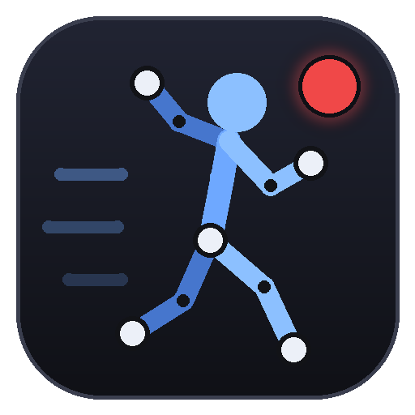

<p align="center">
  
</p>

# VR Motion Recorder

VR Motion Recorder records your body motion and face tracking while you play VRChat, in any world, without Unity
running. It solves the body on your avatar's own skeleton the way VRChat does, lets you review and trim takes and
arrange them in a scene editor, and exports FBX and Unity animation clips. A Blender add-on and a Unity package
carry the result through to editing and rendering.

> **Status:** interim version. Avalonia (`src/Vrmr.App`) is the only desktop app. The Scene workspace, pose tool and layer recorder are not yet available; the GPU renderer and in-software Humanoid clip are still in progress. See [docs/STATUS.md](docs/STATUS.md).

## Who it is for

- **VRChat creators** who want their own performance as animation: dance, acting, gestures, with face and fingers.
- **Animators** who would rather clean up a real performance in Blender than key everything by hand.
- **People who film in Unity** and want the take on their avatar with hair and cloth physics on top.

You do not need full-body tracking. Head and hands alone give an upper body; every tracker you add is used.

## What you need

- **Windows 10 or 11.**
- **VRChat with OSC switched on** (Action Menu → Options → OSC → Enabled). This is where avatar parameters, face
  tracking and VRChat's head and hand poses come from.
- **SteamVR** (optional) for the body: headset, controllers, trackers and finger tracking. The app connects to a
  running SteamVR and never starts it.
- **A face-tracking setup** (optional): whatever drives your avatar's face through VRCFaceTracking is recorded.
- **An avatar you own** (optional): add its base model to see and export your own avatar. A plain mannequin is
  built in.

## Download and first run

1. Download `VRMotionRecorder-<version>-win-x64.zip` from the
   [releases page](https://github.com/miya-sans/vrc-motion-recorder/releases).
2. Unzip it anywhere and start `VRMotionRecorder.exe`. There is no installer and nothing else to install.
   Windows may warn about an app it does not know yet; choose *More info → Run anyway*.
3. The first run walks you through a short setup: what it found (SteamVR, VRChat, Blender, Unity projects), where
   to keep recordings, and which avatar to use. Every step can be skipped and changed later in Settings.

### Or build it yourself

You need [Git](https://git-scm.com) and the [.NET SDK 10](https://dotnet.microsoft.com/download) or later. This
builds the same app the release zip contains:

```
git clone https://github.com/miya-sans/vrc-motion-recorder
cd vrc-motion-recorder
dotnet publish src/Vrmr.App/Vrmr.App.csproj -c Release -r win-x64 --self-contained true -o dist/VRMotionRecorder
```

Then start `dist\VRMotionRecorder\VRMotionRecorder.exe`. To run straight from the source instead, use
`dotnet run --project src/Vrmr.App -c Release`.

Two options are useful for trying things out; with `dotnet run`, put them after `--`
(`dotnet run --project src/Vrmr.App -c Release -- --no-capture`):

- `--data <folder>`: keeps takes and settings in that folder instead of your real ones.
- `--no-capture`: opens takes only, without connecting to SteamVR or VRChat.

## Quick start

1. **Record.** Start VRChat and the app in either order. Calibrate full-body tracking in VRChat as you always do.
   Press the record button, **F9**, or toggle the avatar parameter `VRMR/Record` from your avatar's menu. Press
   again to stop. The take is written to disk while you record, so nothing is lost if something crashes.
2. **Review.** Open the take: the body is solved from the raw data and shown on your avatar. Scrub, trim with
   **I** and **O**, cut with **Del**. Change the calibration, the avatar or a setting, and the take solves again.
3. **Export.** Choose a folder and the formats: an FBX with your avatar, an armature-only FBX, Unity `.anim` clips.
4. **Open it in Blender or Unity.**
   - Blender (4.2 to 5.3): install the [add-on](integrations/blender/README.md) and use **Import VRMR Scene**, or
     import the FBX directly.
   - Unity (2022.3 or later): install the [package](integrations/unity/com.vrmr.motion-bridge/README.md) by Git URL,
     export into your project, and run **Tools → VR Motion Bridge → Create Timeline From Scene**.

     ```
     https://github.com/miya-sans/vrc-motion-recorder.git?path=integrations/unity/com.vrmr.motion-bridge
     ```

## Features

**Recording**

- Works in any world: VRChat's OSC data, SteamVR's devices and VRChat's log are only read.
- Body, fingers (SteamVR Skeletal Input), face tracking, every avatar parameter, and VRChat's camera path.
- Light enough to run next to VRChat, and crash-safe.

**The body solve**

- A full-body IK solve on your avatar's own skeleton, from 3 points (head and hands) up to 11.
- Matched to VRChat's IK 2.0 by measurement: with 11-point tracking the bones are 1.7 cm from VRChat's own pose on
  average, with head, hands, hips and feet 2.1 cm. See [docs/accuracy.md](docs/accuracy.md) for what that means.
- Follows what you did in VRChat: calibrations, spine lock and measurement changes, playspace resets.
- Repairs trackers that drop out, and finds which tracker is on which body part.
- Takes keep the raw data, so everything can be changed afterwards: calibration, avatar, tracker roles, settings.

**Avatars**

- An avatar library for the base models you own; import straight from the avatar's package, no Unity needed.
- Face-tracking shapes from BlendShare add-ons are merged in, so the face plays on the real model.
- Solve any take onto any other humanoid avatar.

**Editing**

- Trim, cut and place takes, with undo. Nothing changes the recording.
- Planned for the Avalonia app: a scene editor with tracks and strips, scored transitions, body-part layers,
  keyframes with an IK pose tool, re-recording, input editing and foot lock. The scene engine exists, but its desktop
  workspace is not yet available.

**Export and pipeline**

- FBX with your avatar's meshes, textures and face shape keys; armature-only FBX; Unity clips for Generic and
  Humanoid rigs; whole scenes with several actors.
- Blender add-on: avatar, face, parameters and cameras in one import; retargeting; **Send to Unity**.
- Unity package: Humanoid set-up, clips and Timelines, ready for a render with physics.

## Privacy

- **Everything stays on your PC.** Takes, scenes, settings and your avatar files are local files. Nothing is
  uploaded.
- **No telemetry, no account, no update checks.** The app makes no connection to the internet.
- **It only reads from VRChat and SteamVR.** It sends no input and writes none of their settings. The one thing it
  can send is the recorded face back to VRChat for a replay, and only when you switch that on.
- **On your network** it listens for VRChat's OSC data on your own computer, and announces that OSC endpoint on
  the local network so VRChat can find it (this is how OSCQuery works). Details are in [SECURITY.md](SECURITY.md).
- **Takes are personal.** A take holds your motion, your avatar's id and name, the world, your VRChat display name
  and your devices' serial numbers. Share one only if you are comfortable with that.

## Building from source

You need the [.NET SDK 10](https://dotnet.microsoft.com/download) or later.

```
git clone https://github.com/miya-sans/vrc-motion-recorder
cd vrc-motion-recorder
dotnet run --project src/Vrmr.App -c Release
```

[CONTRIBUTING.md](CONTRIBUTING.md) covers tests, the project layout and the rules for contributions.

## Documentation

| | |
|---|---|
| [How it works](docs/how-it-works.md) | Data sources, the solve, tracker roles, tracking loss, jumps, avatar scaling. |
| [Calibration](docs/calibration.md) | VRChat-style calibration, every setting, the calibration library. |
| [Avatars](docs/avatars.md) | The avatar library, adding a base model you own, the face. |
| [Scenes](docs/scenes.md) | The scene editor: tracks, transitions, keyframes, re-recording. |
| [Export and pipeline](docs/export-and-pipeline.md) | Export formats, Blender and Unity workflows. |
| [File formats](docs/file-formats.md) | `.vrmr`, `.vrmscene`, manifests and sidecars. |
| [Accuracy](docs/accuracy.md) | How the solve was measured against VRChat, and the results. |
| [Troubleshooting](docs/troubleshooting.md) | No data, no face, no fingers, an avatar that is not recognised. |
| [Architecture](docs/architecture.md), [UI design](docs/ui-design.md) | For contributors. |

## Contributing and support

Bug reports, device reports and feature requests go through the
[issue forms](https://github.com/miya-sans/vrc-motion-recorder/issues/new/choose). The solve was measured on one
setup: reports from other headsets, controllers and trackers are especially welcome. Please read the
[code of conduct](CODE_OF_CONDUCT.md), and report security problems privately as [SECURITY.md](SECURITY.md) says.

## Credits

- Parts of the body IK solver are derived from MIT-licensed software; the notices are in
  [THIRD_PARTY_NOTICES.md](THIRD_PARTY_NOTICES.md).
- The arm, spine and knee behaviour is matched to VRChat's IK 2.0 by measurement on recorded takes; no third-party
  IK source code is included.
- VRChat's own pose, where a take has it, comes through the log format of DrSakuu's
  [Hyakuashi Udon Motion Recorder](https://github.com/DrSakuu/HyakuashiUdonMotionRecorder) (MIT).
- Built with [.NET](https://dotnet.microsoft.com), [Avalonia](https://avaloniaui.net) and the other packages listed
  in the notices.
- The app icon is original to this project (`tools/make_icon.py` draws it) and MIT licensed like the rest.

VR Motion Recorder is a community project. It is not affiliated with or endorsed by VRChat, Valve, Unity or the
Blender Foundation.

## Licence

[MIT](LICENSE). Copyright (c) 2026 miya-sans and VR Motion Recorder contributors.
